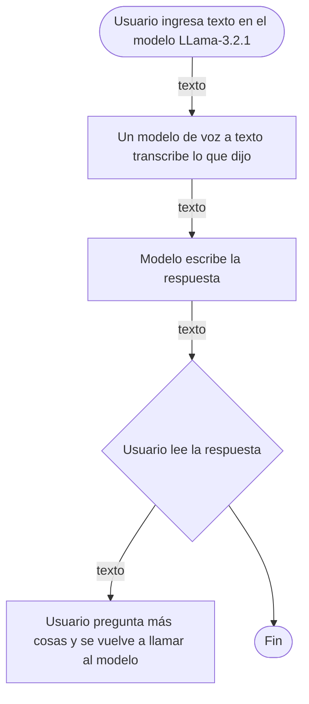

# Tutor conversacional de repaso para estudiantes universitarios
 Proyecto integrador de **Herramientas de Procesamiento para IA (IN1050)** · Universidad Iberoamericana León · Otoño 2026 · Equipo **VRAM Squad**.

> Un tutor conversacional en español que ayuda a estudiantes universitarios a repasar un tema cuando no tienen a un profesor o compañero disponible, especialmente en semanas de alta carga académica. Funciona con un modelo abierto de lenguaje pequeño, ejecutado en Google Colab.

## Equipo
| Integrante | Papel en el proyecto |
|---|---|
| Uriel Gutiérrez Mosqueira | Investigación: impacto ético y referencias |
| Sebastián Guerrero Ambriz | Estructura del repositorio y README |
| Angela de la Rosa Sevilla | Investigación: el problema y soluciones existentes |
| Alejandro Zapien Castrejón | Investigación: modelo, usuarios y requisitos |

Las fichas de cada integrante están en la carpeta [`equipo`](equipo).

## Problemática
Los estudiantes universitarios suelen tener dudas fuera del horario de clase y no siempre hay un profesor o compañero a quien preguntar, sobre todo en semanas de exámenes y entregas. Esto deja dudas sin resolver o las lleva a buscar explicaciones dispersas en internet. Este proyecto propone una primera explicación disponible en cualquier momento, sin sustituir al profesor. El análisis completo está en \[`docs/investigacion.md`](docs/investigacion.md).

## Caso de uso
- **Usuario:** estudiante universitario que quiere repasar un tema.
- **Qué le da al sistema:** el tema o la duda, escritos en lenguaje natural.
- **Qué recibe de vuelta:** una explicación breve en español, a nivel universitario, con la posibilidad de seguir la conversación para pedir más detalle o un ejemplo distinto.

## Modelo
| Campo | Valor |
|---|---|
| Identificador | [`meta-llama/Llama-3.2-1B-Instruct`](https://huggingface.co/meta-llama/Llama-3.2-1B-Instruct) |
| Tarea (pipeline tag) | `text-generation` (chat instruct) |
| Parámetros | ≈ 1.23 mil millones (1.23B) |
| Licencia | Llama 3.2 Community License |
| Limitación declarada por sus autores | Las pruebas se realizaron principalmente en inglés y no cubrieron todos los escenarios posibles, por lo que el modelo puede producir en ocasiones respuestas inexactas, sesgadas o inapropiadas ante ciertas instrucciones. |

## Cómo funciona

## Infraestructura
Memoria mínima para los pesos del modelo, en precisión FP16 (2 bytes por parámetro):
 
$$
\text{Memoria mínima} = 1.23B \times 2\ \text{bytes} \approx \ 2.46\ \text{GB}
$$

Al sumar activaciones, KV cache y overhead del framework, el consumo real en una sesión de chat típica ronda entre 4 y 6 GB de VRAM. La GPU gratuita de Colab (Tesla T4) tiene 14.56 GB de VRAM, así que el modelo cabe con margen amplio.

**Dónde correrá:** localmente en **Colab con GPU**, en lugar de usar una API. El modelo es pequeño y cabe cómodamente en la T4, lo que evita costos por petición y permite iterar sobre el prompt del tutor sin depender de un proveedor externo.

## Riesgo ético

El riesgo principal es la \*\*responsabilidad ante un error\*\*: si el modelo explica mal un concepto, el estudiante puede memorizar información falsa y llegar así al examen. Para mitigarlo, el sistema mostrará siempre un aviso visible de que las respuestas pueden contener errores y deben verificarse con el material del curso, y se limitará el caso de uso a temas de repaso general (no a la resolución de exámenes o tareas calificadas).

## Cambios respecto a la Fase 1

La retroalimentación del profesor nos pidió definir qué podemos añadir nosotros al modelo. A partir de eso, el sistema incorporará:

- **Un prompt de sistema** que define el comportamiento del tutor: respuestas breves en español, a nivel universitario, y pidiendo aclaración cuando la duda es ambigua.

- **Una capa de recuperación de documentos (RAG)** con material del curso, para que las explicaciones se apoyen en fuentes verificables y no solo en lo que el modelo aprendió durante su entrenamiento.

## Siguientes pasos

Para el Parcial III:

- \[ ] Escribir el prompt de sistema del tutor (español, nivel universitario, respuestas breves, pide aclaración si la duda es ambigua)

- \[ ] Preparar un conjunto pequeño de apuntes del curso en texto para usarlo como base de conocimiento

- \[ ] Implementar la recuperación de fragmentos (RAG) para que las respuestas se apoyen en ese material

- \[ ] Implementar la conversación de varios turnos, conservando el historial del chat

- \[ ] Mostrar el aviso de verificación en cada respuesta

- \[ ] Construir una interfaz sencilla de chat (por ejemplo, con Gradio)

- \[ ] Probar el tutor con preguntas de distintas materias, comparar respuestas con y sin RAG y registrar los errores

- \[ ] Subir el código de la aplicación a este repositorio

- \[ ] Preparar la presentación del proyecto

## Referencias
1. Meta. *Llama-3.2-1B-Instruct, Model Card*. Hugging Face. <https://huggingface.co/meta-llama/Llama-3.2-1B-Instruct>

2. Meta. *Llama 3.2 Community License Agreement*. <https://www.llama.com/llama3\_2/license/>

3. Meta. *Responsible Use Guide*. <https://ai.meta.com/llama/responsible-use-guide/>

